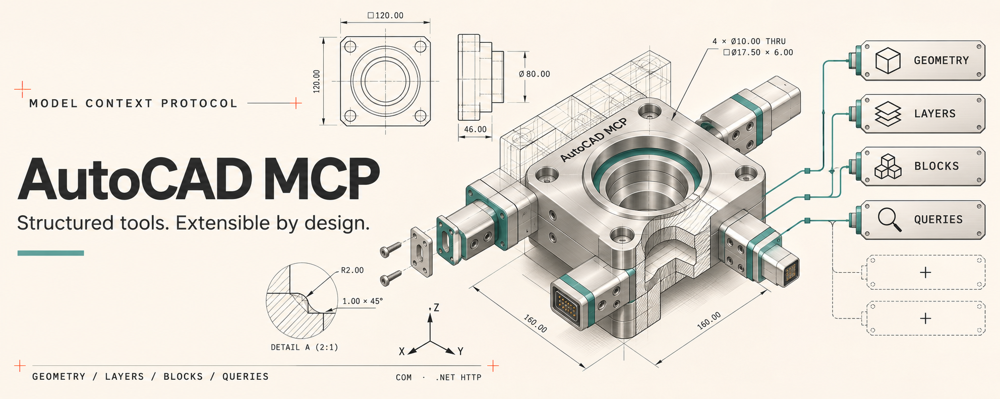
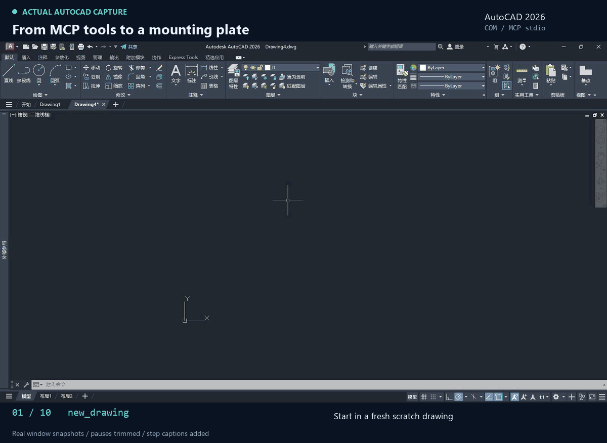

  

<strong>English</strong> · <a href="README.zh-CN.md">简体中文</a>

  
  
  
  

**Connect MCP-compatible AI clients to AutoCAD.** Create geometry, inspect and edit entities, manage layers and blocks, and work with drawings through structured tools. Use Claude Desktop, Cursor, or the included Web UI with your own model provider.

  <a href="#quick-start">Quick start</a> · <a href="#web-ui">Web UI</a> ·
  <a href="#backends">Backends</a> · <a href="#development">Development</a> ·
  <a href="#documentation">Documentation</a>

## See it in AutoCAD

*Actual AutoCAD 2026 window captures using scripted MCP stdio calls through the COM backend. Edited step sequence: pauses trimmed and captions added. [Capture details & verified geometry](docs/validation/2026-11-18-readme-demo.json). The experimental HTTP backend has a separate [Bridge validation report](docs/validation/2026-11-18-http-bridge.json).*

## What you can do

| Capability | Examples |
| --- | --- |
| **Create** | Lines, circles, arcs, polylines, rectangles, text, hatches and dimensions |
| **Inspect & edit** | Entity details, region queries, move/rotate/copy/scale/mirror/delete |
| **Organize** | Layers, block insertion, block attributes and bulk attribute checks |
| **Use references** | Local symbol catalogs and read-only layout extraction from reference drawings |
| **Choose a model** | Streaming Web UI: Anthropic, OpenAI, OpenAI-compatible endpoints and Doubao |
| **Extend understanding** | Optional local drawing VQA service |

**44 registered MCP tools.** Default COM provides the existing CAD tool surface. Eight additive tools expose runtime status, atomic batches, pagination and controlled working drawings with saved-artifact reopening. Experimental HTTP supports a smaller, documented subset. See the [tool migration matrix](docs/design/tool-migration-matrix.md).

**Cader integration:** an explicit seven-tool [`cader-cad/1` stdio profile](docs/design/cader-managed-profile.md) provides versioned DTOs, native job identity and revision tracking. Two actual Cader CLI runs passed drawing → DWG save → read-only reopen → independent verification for the reviewed line/circle/text fixture. [Evidence and limits](docs/validation/2026-11-19-cader-managed-profile.md).

## Quick start

### 1. Prepare the environment

- **Windows** with AutoCAD installed; development and native validation use AutoCAD 2026.
- **Python 3.11+**. The commands below use conda.
- A compatible AI client, or a model endpoint for the optional Web UI.

~~~powershell
git clone https://github.com/codesknight/AutoCAD-MCP.git
cd AutoCAD-MCP
conda create -n autocad-mcp python=3.11 -y
conda activate autocad-mcp
python -m pip install -e .
~~~

Prefer Python venv?

~~~powershell
py -3.11 -m venv .venv
.\.venv\Scripts\Activate.ps1
python -m pip install -e .
~~~

### 2. Open AutoCAD normally

Check the ProgID in [config.json](src/autocad_mcp/config.json); the development machine uses `AutoCAD.Application.25.1`. Use one COM write-serving process per AutoCAD instance.

Before experimenting with write tools, ask the client to run **`new_drawing`** so test geometry goes into a fresh drawing.

### 3. Connect an MCP client

Find the absolute Python path in the environment where you installed the project:

~~~powershell
python -c "import sys; print(sys.executable)"
~~~

Add this entry to your client's MCP configuration. For Claude Desktop on Windows, the file is usually `%APPDATA%\Claude\claude_desktop_config.json`.

~~~json
{
  "mcpServers": {
    "autocad-mcp": {
      "command": "C:\\Users\\<you>\\.conda\\envs\\autocad-mcp\\python.exe",
      "args": ["-m", "autocad_mcp.server"]
    }
  }
}
~~~

Use the environment's `python.exe` directly. Tool discovery is lazy and does not require connecting to AutoCAD.

For development with MCP Inspector:

~~~powershell
mcp dev src/autocad_mcp/server.py
~~~

### 4. Try a small task

> Create a new blank drawing. Add a layer named DEMO, draw a line from (0, 0, 0) to (10, 0, 0), and add a circle centered at (20, 0, 0) with radius 5. Query the drawing and check the result.

## Web UI

The Web UI connects through a real MCP client, with streamed replies and individual tool-call updates.

~~~powershell
python -m pip install -e ".[web]"
~~~

From the **project root**, use two terminals in the same Python environment:

~~~powershell
# Terminal 1 — MCP Streamable HTTP, loopback port 8931
python -m autocad_mcp.server --http
~~~

~~~powershell
# Terminal 2 — Web UI backend, loopback port 8000
python -m uvicorn web.backend.app:app --host 127.0.0.1 --port 8000
~~~

Open [127.0.0.1:8000](http://127.0.0.1:8000), select a provider/model, and supply your API credentials.

This UI is for local, single-user use: no authentication, in-memory history, and no conversation persistence across restarts.

Credentials for scripted development

Keep test credentials in an untracked `.env` and have your script read it. The Web UI does not automatically load these values.

~~~dotenv
doubao_base_url=https://ark.cn-beijing.volces.com/api/v3
doubao_model_name=ep-xxxxxxxx-xxxxx
doubao_api_key=YOUR_KEY
~~~

Call `POST /api/chat/stream` or `POST /api/chat` from the script. Never commit real credentials or paste them into documentation.

## Backends

| | COM — default | .NET HTTP Bridge — experimental |
| --- | --- | --- |
| CAD execution | Python COM adapter on one STA worker | AutoCAD plugin, main-thread queue and transactions |
| Current scope | Existing CAD tools | Thirteen legacy CAD tools, plus runtime and controlled-document tools; see migration evidence |
| Atomic batch | Not supported | MCP tool for 1–200 transactional layer/line/circle/arc/rectangle/polyline/text/mtext/dimension operations |
| Query pagination | Existing legacy query | MCP pages of up to 1,000 items, filters, field projection and revision-bound cursors |
| Setup | Python + running AutoCAD | Matching .NET SDK, plugin build/NETLOAD, local token |
| Write behavior | Existing COM workflow; one write entry point | Bridge-created documents only; explicit document binding |
| Details | [COM foundation](docs/design/backend-foundation.md) | [Install, configure & validate](docs/design/http-bridge.md) |

Both paths keep the MCP tool layer. Unsupported HTTP operations return an explicit error; writes never fall back to COM.

See [controlled drawing, save and reopen contracts](docs/design/controlled-working-drawings.md) and [runtime tool examples and recovery rules](docs/design/mcp-runtime-tools.md) for explicit document IDs, batch steps and cursor handling.

See the [native fault and reproducible performance report](docs/validation/2026-11-19-cad09.md), including failed samples and qualification limits. COM remains the default.

**MCP HTTP and the CAD Bridge are separate interfaces.** `--http` selects MCP Streamable HTTP on port **8931**. `backend: "http"` selects the CAD Bridge on port **8765**. The default remains COM.

~~~mermaid
flowchart LR
    Client["MCP clients"] -->|"stdio / Streamable HTTP"| MCP["Python MCP server & tools"]
    Web["Web UI · model providers"] -->|"MCP Streamable HTTP"| MCP
    MCP --> Factory["Backend factory"]
    Factory -->|"default"| COM["COM · serial STA worker"]
    Factory -->|"experimental HTTP"| Bridge[".NET Bridge · CAD queue / transactions"]
    COM --> CAD["AutoCAD"]
    Bridge --> CAD
    MCP --> Optional["Local resources · optional VQA"]
~~~

## Development

~~~powershell
python -m pip install -e ".[dev]"
python -m pytest -q
~~~

Default tests run without AutoCAD. Real CAD tests require explicit opt-in:

~~~powershell
# Open AutoCAD normally first; tests create scratch drawings.
python -m pytest tests/test_backend_integration.py --cad-integration -q -s

# Export actual MCP stdio tools/list without connecting to CAD.
python scripts/export_mcp_contract.py --output tools.json
~~~

The [controlled-document qualification](docs/validation/2026-11-19-controlled-documents.md) adds real DWG save/read-only reopen, extended batch rollback and file guards. The earlier [runtime and drawing verification report](docs/validation/2026-11-19-mcp-runtime.md) documents **103 Python tests passed**, 33 CAD tests skipped, 34 C# assertions, real MCP stdio pagination of 1,205 entities and five native drawing tools. It retains the native failure, correction and cleanup recheck. Earlier stdio/Streamable HTTP checks remain in the [initial record](docs/validation/2026-11-18-http-bridge.json). See [CI runs](https://github.com/codesknight/AutoCAD-MCP/actions) for current branch results.

Native verification uses **normal AutoCAD startup, then attachment**; automatic startup compatibility remains under investigation. The harness closes its test drawings and stops its listener. Helpers must clean up CAD processes they create while preserving user-owned instances.

## Documentation

| Start here | Details |
| --- | --- |
| [Architecture](docs/design/architecture.md) | Layers, integrations and project structure |
| [HTTP Bridge guide](docs/design/http-bridge.md) | Build, authentication, protocol, validation and known issues |
| [Tool matrix](docs/design/tool-migration-matrix.md) | Per-tool migration and verification status |
| [Roadmap](docs/design/development-roadmap.md) | Planned work and acceptance criteria |
| [Development log](docs/logs/devlog.md) | Changes, experiments and incident records |
| [Project conventions](CLAUDE.md) | Development and drawing-safety rules |

Repository layout

~~~text
src/autocad_mcp/    MCP server, tools, configuration and CAD backends
plugin/            Native Bridge and C# contract/hosting checks
web/               Web client, agent loop and model providers
tests/             Python regressions, MCP contracts and opt-in CAD tests
schemas/           Versioned Bridge JSON schemas
scripts/           Build, verification, asset and data utilities
docs/              Design, validation evidence, artwork and development log
~~~

Reference drawings, symbol DWGs and the optional VQA model/service are external resources, not bundled with this repository. The VQA proxy defaults to loopback port **8933**; the other tools work without it.

## Contributing & license

[Report a bug or propose a feature](https://github.com/codesknight/AutoCAD-MCP/issues/new/choose). Include your AutoCAD build, backend, reproduction steps and redacted logs. Keep PRs focused and append the development log for substantive changes.

Released under the [MIT license](LICENSE). Inspired by [daobataotie/CAD-MCP](https://github.com/daobataotie/CAD-MCP); see the [reference analysis](docs/references/cad-mcp-analysis.md).

<a href="README.zh-CN.md">切换到简体中文 →</a>

## Native new-document safety (2026-11-23)

COM attach no longer implicitly creates drawings. Explicit new_drawing resolves native Add metadata with bounded read-only readiness, invokes once, and binds only a uniquely new active document. Failures after invocation never retry creation. Optional request_id correlates native preflight/call/binding evidence; it is not idempotency or replay authority. MCP errors retain isError=true and native evidence. Legacy no-argument calls and successful document-name results remain compatible. This tool omits its former success-only outputSchema so error evidence is not misvalidated. Clients must validate full evidence and request identity; old errors cannot retrospectively prove no execution. Tests and limits: issue41 and docs/logs/devlog.md.
