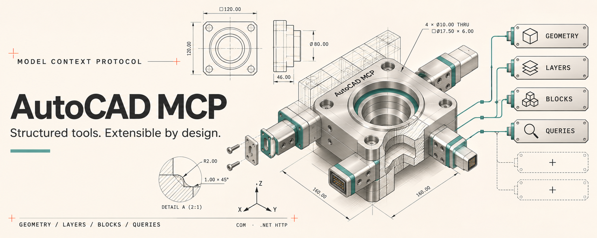
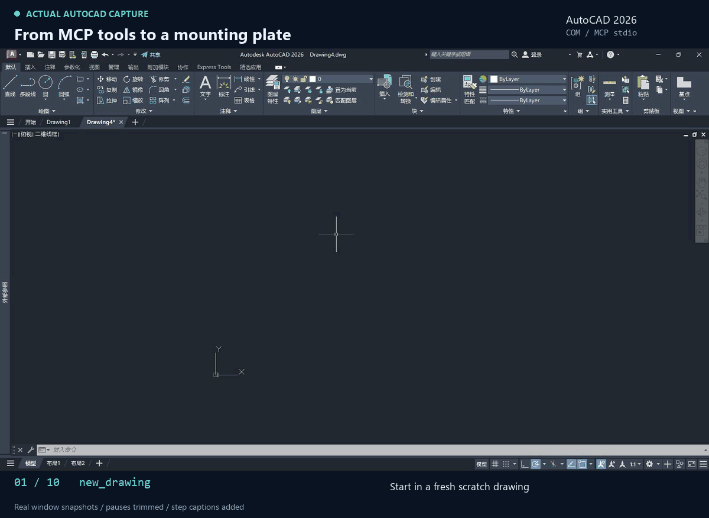

  

<a href="README.md">English</a> · <strong>简体中文</strong>

  
  
  
  

**让支持 MCP 的 AI 客户端连接 AutoCAD。** 通过结构化工具创建几何图形、查询和编辑实体、管理图层与块，并操作图纸。支持 Claude Desktop、Cursor，也可以使用项目自带的 Web UI 接入自己的模型服务。

  <a href="#快速开始">快速开始</a> · <a href="#web-ui">Web UI</a> ·
  <a href="#后端选择">后端选择</a> · <a href="#开发与验证">开发与验证</a> ·
  <a href="#项目文档">项目文档</a>

## 实机演示

*AutoCAD 2026 实机画面，通过脚本执行 MCP stdio 调用，使用 COM 后端。按工具步骤采集并剪辑，已缩短停顿、添加步骤字幕。详见[画面来源与几何验证记录](docs/validation/2026-11-18-readme-demo.json)；实验性 HTTP 后端另见 [Bridge 验证报告](docs/validation/2026-11-18-http-bridge.json)。*

## 主要能力

| 能力 | 示例 |
| --- | --- |
| **创建图形** | 直线、圆、圆弧、多段线、矩形、文字、填充与标注 |
| **查询与编辑** | 实体详情、区域查询、移动、旋转、复制、缩放、镜像与删除 |
| **组织图纸** | 图层、块插入、块属性与批量属性检查 |
| **使用参考资源** | 本地符号目录、参考图纸布局的只读提取 |
| **选择模型** | 流式 Web UI：Anthropic、OpenAI、OpenAI 兼容接口与豆包 |
| **扩展图纸理解** | 可选的本地图纸视觉问答（VQA）服务 |

**共注册 47 个 MCP 工具。** 默认 COM 后端提供既有 CAD 工具能力；八项工具提供运行时状态、原子批处理、分页和受控工作图的保存重开，另有三项显式[执行证据工具](docs/design/execution-evidence.md)提供文档绑定、限域 COM 回执和只读请求对账。原 44 项工具签名保持兼容。实验性 HTTP 后端目前支持其中一部分。逐项状态见[工具迁移矩阵](docs/design/tool-migration-matrix.md)。

**配套 Agent：[Cader](https://github.com/codesknight/Cader)。** Cader 是可扩展的 CAD Agent Harness，规划任务、通过 AutoCAD-MCP 调用 CAD 工具并验证结果；本项目提供 CAD 操作能力，Cader 负责 Agent 工作流。

独立的七工具 [`cader-cad/1` stdio 入口](docs/design/cader-managed-profile.md)提供版本化 DTO、原生 job 身份与 revision 对账。两轮真实 Cader CLI 已通过直线/圆/文字固定计划的绘制→保存 DWG→只读重开→独立验收；[查看证据和适用范围](docs/validation/2026-11-19-cader-managed-profile.md)。

[首批执行证据 P0 报告](docs/validation/2026-11-25-execution-evidence-p0.md)保留早期失败与写入冻结记录；[后续联合回归](https://github.com/codesknight/AutoCAD-MCP/pull/46)已通过房子及原始电路用例。P1 第一批提供[普通 COM 文件保存、哈希和独立只读重开](docs/design/com-file-artifacts.md)，[实机接口回归](docs/validation/2026-11-25-com-artifact-p1.md)复用已验收 DWG；Cader 接入这些新操作后仍需单独验收。

## 快速开始

### 1. 准备环境

- **Windows**，已安装 AutoCAD；当前开发与原生验证使用 AutoCAD 2026。
- **Python 3.11+**，以下命令使用 conda。
- 支持 MCP 的 AI 客户端，或用于可选 Web UI 的模型接口。

~~~powershell
git clone https://github.com/codesknight/AutoCAD-MCP.git
cd AutoCAD-MCP
conda create -n autocad-mcp python=3.11 -y
conda activate autocad-mcp
python -m pip install -e .
~~~

更习惯使用 Python venv？

~~~powershell
py -3.11 -m venv .venv
.\.venv\Scripts\Activate.ps1
python -m pip install -e .
~~~

### 2. 正常打开 AutoCAD

检查 [config.json](src/autocad_mcp/config.json) 中的 ProgID；开发机使用 `AutoCAD.Application.25.1`。同一个 AutoCAD 实例应只使用一个 COM 写入服务进程。

试用写入工具前，先让客户端调用 **`new_drawing`**，把测试图形画在新建图纸中。

### 3. 配置 MCP 客户端

在已安装本项目的 Python 环境中，查询解释器的绝对路径：

~~~powershell
python -c "import sys; print(sys.executable)"
~~~

将以下配置加入客户端的 MCP 设置。Windows 上 Claude Desktop 的配置文件通常是 `%APPDATA%\Claude\claude_desktop_config.json`。

~~~json
{
  "mcpServers": {
    "autocad-mcp": {
      "command": "C:\\Users\\<you>\\.conda\\envs\\autocad-mcp\\python.exe",
      "args": ["-m", "autocad_mcp.server"]
    }
  }
}
~~~

用实际路径替换 `<you>` 示例，直接指定环境中的 `python.exe`。工具发现采用延迟连接，不要求先连接 AutoCAD。

开发时也可以使用 MCP Inspector：

~~~powershell
mcp dev src/autocad_mcp/server.py
~~~

### 4. 试一个小任务

> 新建一张空白图纸。创建 DEMO 图层，绘制一条从 (0, 0, 0) 到 (10, 0, 0) 的直线，再绘制一个圆心为 (20, 0, 0)、半径为 5 的圆。查询图纸并检查结果。

## Web UI

Web UI 通过真实 MCP 客户端调用工具，支持流式回复和逐项工具调用状态。

~~~powershell
python -m pip install -e ".[web]"
~~~

在**项目根目录**打开两个终端，使用同一个 Python 环境：

~~~powershell
# 终端 1：MCP Streamable HTTP，回环端口 8931
python -m autocad_mcp.server --http
~~~

~~~powershell
# 终端 2：Web UI 后端，回环端口 8000
python -m uvicorn web.backend.app:app --host 127.0.0.1 --port 8000
~~~

打开 [127.0.0.1:8000](http://127.0.0.1:8000)，选择服务商与模型，填写自己的 API 凭据。

该界面面向本机单用户使用：没有身份认证，历史记录仅保存在内存中，重启后不保留对话。

脚本开发时如何配置凭据

将测试凭据放在不受版本控制的 `.env` 中，由脚本显式读取。Web UI 不会自动加载这些值。

~~~dotenv
doubao_base_url=https://ark.cn-beijing.volces.com/api/v3
doubao_model_name=ep-xxxxxxxx-xxxxx
doubao_api_key=YOUR_KEY
~~~

脚本可调用 `POST /api/chat/stream` 或 `POST /api/chat`。不要提交真实凭据，也不要将它们写进文档。

## 后端选择

| | COM（默认） | .NET HTTP Bridge（实验性） |
| --- | --- | --- |
| CAD 执行方式 | Python COM 适配器，单个 STA 工作线程 | AutoCAD 插件、主线程队列与事务 |
| 当前范围 | 既有 CAD 工具 | 13 项旧 CAD 工具，加运行时与受控工作图工具；验证状态见迁移记录 |
| 原子批处理 | 不支持 | MCP 工具，支持 1–200 步图层、线、圆、圆弧、多段线、文字和标注事务操作 |
| 查询分页 | 既有查询接口 | MCP 每页最多 1000 项，支持过滤、字段裁剪与绑定 revision 的游标 |
| 安装要求 | Python 与已打开的 AutoCAD | 匹配的 .NET SDK、编译/NETLOAD 插件、本地令牌 |
| 写入行为 | 既有 COM 流程；保持单一写入入口 | 仅写入 Bridge 创建的图纸；显式绑定文档 |
| 详细说明 | [COM 基础设计](docs/design/backend-foundation.md) | [安装、配置与验证](docs/design/http-bridge.md) |

两种后端共用 MCP 工具层。HTTP 后端不支持的操作会明确报错，写入不会回退到 COM。

工作图身份、单位、保存和只读重开见[受控工作图契约](docs/design/controlled-working-drawings.md)；显式文档 ID、批处理步骤和游标恢复方式见[运行时工具示例](docs/design/mcp-runtime-tools.md)。

查看[原生故障与可复现性能报告](docs/validation/2026-11-19-cad09.md)，其中保留失败样本和验收限制。默认后端仍为 COM。

**MCP HTTP 与 CAD Bridge 是两个独立接口。** `--http` 选择端口 **8931** 的 MCP Streamable HTTP；`backend: "http"` 选择端口 **8765** 的 CAD Bridge。默认后端仍为 COM。

~~~mermaid
flowchart LR
    Client["MCP 客户端"] -->|"stdio / Streamable HTTP"| MCP["Python MCP 服务与工具"]
    Web["Web UI · 模型服务"] -->|"MCP Streamable HTTP"| MCP
    MCP --> Factory["后端工厂"]
    Factory -->|"默认"| COM["COM · 串行 STA 线程"]
    Factory -->|"实验性 HTTP"| Bridge[".NET Bridge · CAD 队列 / 事务"]
    COM --> CAD["AutoCAD"]
    Bridge --> CAD
    MCP --> Optional["本地资源 · 可选 VQA"]
~~~

## 开发与验证

~~~powershell
python -m pip install -e ".[dev]"
python -m pytest -q
~~~

默认测试不启动 AutoCAD。真实 CAD 测试需要显式启用：

~~~powershell
# 先正常打开 AutoCAD；测试会创建临时图纸。
python -m pytest tests/test_backend_integration.py --cad-integration -q -s

# 通过真实 MCP stdio tools/list 导出工具契约，不连接 CAD。
python scripts/export_mcp_contract.py --output tools.json
~~~

新增[受控工作图实机报告](docs/validation/2026-11-19-controlled-documents.md)，验证 DWG 保存重开、扩展事务回滚及文件边界。此前[运行时与绘图验证报告](docs/validation/2026-11-19-mcp-runtime.md)包含 **103 项 Python 测试通过**、跳过 33 项 CAD 测试、34 项 C# 断言，以及真实 MCP stdio 的 1205 实体分页和五项原生绘图。原生失败、修复与清理复核均保留；早期 stdio / Streamable HTTP 验证见[初次记录](docs/validation/2026-11-18-http-bridge.json)。分支执行结果见 [CI 记录](https://github.com/codesknight/AutoCAD-MCP/actions)。

原生验证采用**正常启动 AutoCAD 后再连接**的方式；自动启动兼容性仍在排查。验证脚本会关闭自己的测试图纸并停止监听。开发辅助程序应清理自己创建的 CAD 进程，同时保留用户原有实例。

## 项目文档

| 从这里开始 | 内容 |
| --- | --- |
| [架构设计](docs/design/architecture.md) | 分层、集成方式与项目结构 |
| [HTTP Bridge 指南](docs/design/http-bridge.md) | 编译、认证、协议、验证与已知问题 |
| [工具矩阵](docs/design/tool-migration-matrix.md) | 各工具的迁移和验证状态 |
| [开发路线图](docs/design/development-roadmap.md) | 后续计划与验收标准 |
| [开发日志](docs/logs/devlog.md) | 变更、实验与事故记录 |
| [项目约定](CLAUDE.md) | 开发规范与图纸安全规则 |

仓库目录

~~~text
src/autocad_mcp/    MCP 服务、工具、配置与 CAD 后端
plugin/            原生 Bridge 与 C# 契约/宿主检查
web/               Web 客户端、Agent 循环与模型服务商
tests/             Python 回归、MCP 契约与可选 CAD 测试
schemas/           带版本的 Bridge JSON Schema
scripts/           编译、验证、素材与数据工具
docs/              设计、验证记录、视觉素材与开发日志
~~~

参考图纸、符号 DWG 和可选 VQA 模型/服务均为外部资源，不随仓库分发。VQA 代理默认使用回环端口 **8933**；其余工具无需该服务即可使用。

## 参与贡献与许可

[报告问题或提出功能建议](https://github.com/codesknight/AutoCAD-MCP/issues/new/choose)时，请附上 AutoCAD 版本、所用后端、复现步骤与脱敏日志。PR 请聚焦单一主题；实质性修改需追加开发日志。

本项目采用 [MIT 许可证](LICENSE)。参考并改进自 [daobataotie/CAD-MCP](https://github.com/daobataotie/CAD-MCP)，详见[参考项目分析](docs/references/cad-mcp-analysis.md)。

<a href="README.md">Switch to English →</a>

## 模型视图捕获与恢复核验（2026-11-24）

`export_current_view(file_path="", request_id="")`在修改打印状态前检查模型实体数、范围和COM方法就绪；前台原生打印只调用一次。恢复后读回核对布局归属、涉及的打印参数、BACKGROUNDPLOT、QuietErrorMode及临时配置清理。未知变更保留恢复证据，捕获要求模型布局，不自动切换用户纸布局。

旧成功调用保留路径文本及structured result包装；传request_id时附autocad-capture/1回执，失败保留isError=true和阶段/恢复证据。关联值不是幂等或重放授权，客户端须完整核对回执及请求/路径/文档；旧unknown不追溯解除。[真实回归与限制](docs/validation/2026-11-24-capture-restoration.md)。

## 原生新图创建保护（2026-11-23）

COM连接不再隐式造图。显式new_drawing只读解析Add原生元数据并有界等待，创建只调用一次，绑定须确认唯一新增活动文档。调用后异常不重试创建。可选request_id用于关联前置/调用/绑定证据，不是幂等或重放授权；错误保留isError=true及原生证据。旧无参调用、成功图名兼容；该工具取消只声明成功的outputSchema，避免错误证据被误校验。客户端须完整校验关联证据，不能回溯证明旧错误未执行。测试及限制见issue41与docs/logs/devlog.md。
