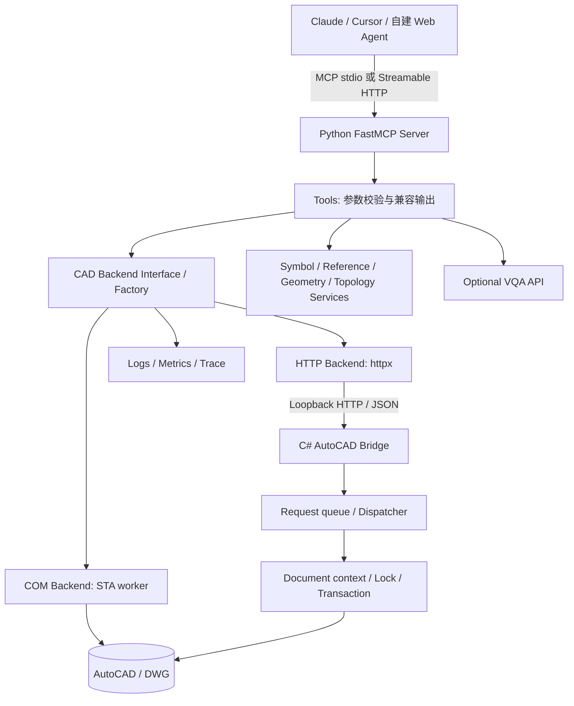
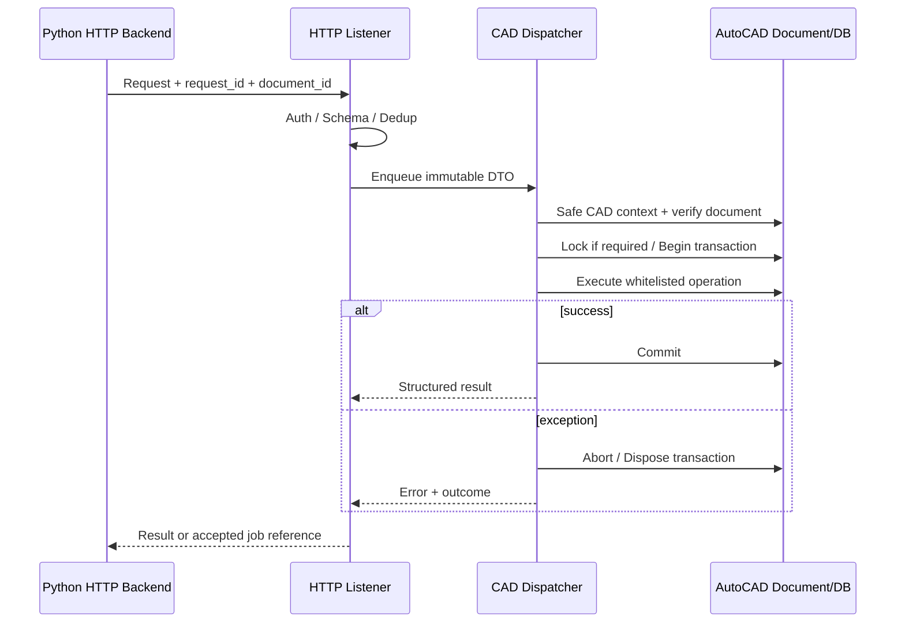
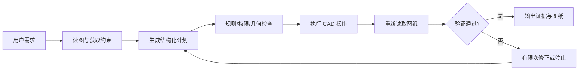
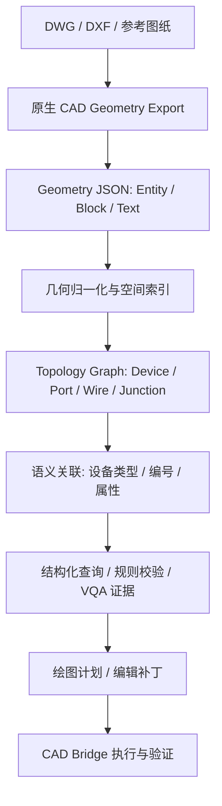

# AutoCAD-MCP 后续开发路线图与技术实施方案

> 版本：v1.0（设计草案）<br>
> 日期：2026-11-18<br>
> 仓库：[codesknight/AutoCAD-MCP](https://github.com/codesknight/AutoCAD-MCP)<br>
> 建议归档：`docs/design/development-roadmap.md`<br>
> 状态：待实施、待实机验证；本文不是已完成的开发记录。

## 1. 项目定位与技术决策

将 AutoCAD-MCP 从基于 COM 的自然语言 CAD 工具集，逐步演进为具备稳定执行、结构化图纸理解、可验证绘图和专业领域扩展能力的 CAD Agent 基础设施。

**核心决策：保留 Python + FastMCP 作为工具接入层，保留 COM 兼容后端，开发 HTTP + C#/.NET 原生插件作为候选主后端；通过基准测试决定何时切换默认后端。**

HTTP 是进程间传输方式，COM 和 .NET 是 CAD 操作方式。现有 MCP Streamable HTTP 与新增 CAD Bridge HTTP 是两个独立接口，不应混用。HTTP 不会天然比 COM 更快，主要收益来自 CAD 进程内批处理、数据库访问、事务和统一执行调度。

| 决策 | 方案 | 理由 |
| --- | --- | --- |
| 上层协议 | MCP stdio + Streamable HTTP | 兼容现有 AI 客户端及 Web UI |
| CAD 内核访问 | 双后端：COM / .NET | 渐进迁移、控制回归风险 |
| 下层通信 | 本地 HTTP + JSON | 调试直观、便于跨进程解耦；后续可评估 Named Pipe |
| 并发 | 每个 AutoCAD 实例统一串行调度 | 防止文档状态和线程冲突 |
| 数据协议 | 统一 DTO、错误码、能力声明 | 后端可替换，便于 Agent 恢复 |
| 开发策略 | 先验证最小闭环，再迁移高价值接口 | 避免一次性重写 |
| 发布策略 | COM 默认 → HTTP 实验 → HTTP 推荐 | 未通过验收不改变默认值 |

### 1.1 范围

- P0：后端抽象、原生插件、线程调度、实体查询/创建、事务、安全、实机 Benchmark。
- P1：现有 CAD 工具覆盖、图纸状态管理、批处理、可观测性、安装发布。
- P2：Geometry / Topology、标准电力符号库、参考图纸、VQA 证据融合、Agent 评测与数据闭环。
- 暂不做：自研大模型训练框架、远程多租户 CAD 平台、任意脚本执行接口、全面替换 Web UI、全量 DWG 格式解析器。

## 2. 现状与迁移切入点

依据公开仓库 README、架构文档及部分 Python 源码 [1–7]：现有系统已具有 COM 绘图/查询、文档工具、参考图纸库、可选 VQA 服务、多模型 Web UI 及 MCP 两种传输方式。架构文档称已有约 36 个工具完成端到端验证；实际清单、测试覆盖和性能基线需在开发开始时重新采集（`tools/list` 为准）。

| 已有路径/模块 | 当前职责 | 下一步 |
| --- | --- | --- |
| `src/autocad_mcp/server.py` | FastMCP 注册；stdio / HTTP（8931） | 保留协议入口与工具注册 |
| `src/autocad_mcp/state.py` | 懒连接、进程级 controller/query 单例 | **首要重构点**：统一后端工厂及生命周期 |
| `src/autocad_mcp/config.py` / `config.json` | CAD 类型、ProgID、连接超时等 | 新增后端类型、Bridge 配置与权限策略 |
| `cad/connection.py` | COM 附着/启动、活动文档引用 | 封装到 COM 后端；验证 STA、重连与文档切换 |
| `cad/controller.py`、`cad/query.py` | 绘图、图层、实体、图块操作 | 保留算法，包装为统一接口 |
| `tools/drawing_tools.py`、`tools/query_tools.py` | 工具参数、输出格式 | 先冻结签名；内部通过后端访问 |
| `tools/document_tools.py` | 文档和视图操作 | 迁移到显式文档会话，支持安全工作区 |
| `cad/symbol_library.py`、`cad/reference_library.py` | 资源与参考图纸 | 资源索引层保留；CAD 访问部分抽象 |
| `tools/vqa_tools.py` | 转发可选 VQA 服务 | 保持独立；增加图纸版本与结构证据 |
| `web/`、`scripts/`、`tests/` | Web Agent、数据脚本、测试 | 尽量复用；补足契约、回归与基准 |

源码抽样还显示：当前 `state.py` 的 `get_controller()` 在首次创建控制器时会无条件重建连接，而 `get_query()` 只在没有连接时新建。若先查询再绘图，两个对象可能持有不同连接；需要先编写回归测试确认，再统一生命周期。COM 文档缓存是否会在文档切换后失效，也应测试，而不是假设一定发生。

## 3. 目标架构



### 3.1 职责边界

Python：MCP 工具注册、参数与业务权限校验、后端选择、模型编排、结构化图纸算法、数据导出及评测。C#：AutoCAD SDK 调用、对象生命周期、线程切换、文档锁、事务、执行反馈。Bridge 不依赖 LLM，不需要读取模型 API Key，不直接接收自由文本命令。VQA 模型不嵌入 AutoCAD 进程。

同一 CAD 实例只能存在一个有权写入的后端执行入口；COM 和 HTTP 是运行配置选项，而不是两个可随意并发的写通道。多个 MCP 客户端需要共享一个受控写入入口；推荐 HTTP 模式下由 Bridge 统一排队，COM 模式下使用共享服务进程或限制为单写客户端。切换后端前等待队列清空，不自动重放未确认的写操作。

### 3.2 建议新增目录（现有模块先保留原位）

```text
AutoCAD-MCP/
├── src/autocad_mcp/
│   ├── server.py
│   ├── state.py                  # backend 生命周期与兼容访问器
│   ├── config.py
│   ├── config.json
│   ├── tools/                    # 原工具签名优先保持不变
│   ├── cad/
│   │   ├── connection.py         # 现有 COM 代码暂不搬迁
│   │   ├── controller.py
│   │   ├── query.py
│   │   ├── backends/
│   │   │   ├── base.py
│   │   │   ├── factory.py
│   │   │   ├── com_backend.py
│   │   │   └── http_backend.py
│   │   ├── models.py            # DTO / EntityRef / Result
│   │   └── errors.py
│   └── domain/                  # 后续 Geometry / Topology / Electrical
├── plugin/AutoCADBridge/
│   ├── AutoCADBridge.csproj
│   ├── Plugin.cs
│   ├── Transport/HttpServer.cs
│   ├── Execution/CadDispatcher.cs
│   ├── Execution/OperationRegistry.cs
│   ├── Execution/RequestJournal.cs
│   ├── Services/
│   │   ├── DocumentService.cs
│   │   ├── DrawingService.cs
│   │   ├── QueryService.cs
│   │   └── BatchService.cs
│   └── Contracts/
├── schemas/bridge/v1/           # 共享 JSON Schema 与样例
├── tests/                       # 保留并增补契约、实机、MCP 端到端测试
├── benchmarks/                  # fixture 生成、运行器、原始结果
├── scripts/                     # build/install/smoke 等脚本
├── web/                         # 现有 Web UI
└── docs/design/development-roadmap.md
```

目录和新模块均为建议，不代表已存在。先通过 adapter 复用现有 COM 代码，避免同时进行移动文件和行为变更。

## 4. P0：后端抽象与稳定性规范

### 4.1 后端接口

不要在工具层写 `if backend == 'http'`。将后端选择集中在工厂；保留 `get_controller()`、`get_query()` 等兼容入口，逐步令其返回不依赖 COM 类型的 adapter。先按读、写、文档操作拆分协议；以下是最小接口设计示意，并非可直接运行的提交：

```python
from typing import Any, Protocol

class CadBackend(Protocol):
    def capabilities(self) -> dict[str, Any]: ...
    def status(self) -> dict[str, Any]: ...
    def execute(self, operation: str, payload: dict[str, Any], *,
                document_id: str | None, request_id: str) -> dict[str, Any]: ...
    def close(self) -> None: ...
```

内部使用类型化 Pydantic DTO 和操作白名单；不要把通用 `execute` 原样暴露成任意命令的 MCP 工具。未知操作返回 `UNSUPPORTED_OPERATION`。新增工具通过能力探测决定是否可用，旧工具返回格式先不变。

### 4.2 配置与版本协商

以下是 v1 建议新增的字段；与现在的配置模型合并，不覆盖已有 `cad_type`、`prog_id_fallbacks`、`connect_timeout`、`visible` 等字段：

```json
{
  "backend": "com",
  "cad_type": "AutoCAD",
  "prog_id": "AutoCAD.Application.25.1",
  "http": {
    "base_url": "http://127.0.0.1:8765",
    "connect_timeout_seconds": 3,
    "request_timeout_seconds": 30,
    "token_env": "AUTOCAD_BRIDGE_TOKEN"
  },
  "workspace_root": "./workspace",
  "write_policy": "managed_documents_only"
}
```

`backend` 缺省为 `com`；开发环境可通过配置或 CLI 显式使用 HTTP。不同地址：Web UI 8000、MCP 8931、VQA 8933（仓库现状）、Bridge 8765（拟定，可配置）。连接时核对 `protocol_version`、`instance_id`、操作能力及 AutoCAD 版本。不兼容时明确报错，不能把已经发往 HTTP 的写请求自动降级到 COM 执行。

### 4.3 实体身份与文档绑定

- 现有工具使用整数 `ObjectID`。v1 先保留，对 .NET 后端验证 `ObjectId` 与旧 COM 数值能否等价转换；不要猜测或强转。若无法可靠映射，在 HTTP 模式通过兼容 ID 表维护会话内映射，并提前说明兼容范围。对外传输大整数时避免 JavaScript 超过 2^53-1 的精度损失。
- 新的结构化协议使用 `instance_id + document_id + handle`；Handle 为十六进制字符串，在同一数据库中相对稳定，并非跨 DWG、复制、重建的全局 ID。`document_id` 为每次加载的文档会话 ID，另可提供持久图纸指纹。文档关闭或 CAD 重启后旧会话 ID 失效。
- 每个写请求在入队时绑定目标文档，执行前复核该文档仍存在、允许写入、版本符合预期。禁止在执行时静默改为当前活动图纸。
- 无显式文档参数的旧工具由 adapter 在提交时解析目标；默认只自动写入 MCP 创建或明确授权的文档。真实历史图纸、参考图纸默认只读。
- `revision` 是版本控制令牌，由插件对已观察到的数据库变化保守失效；用户手工编辑也须覆盖。无法保证实时版本一致性时拒绝需要强一致性的操作或重新读取，不伪造版本号。

### 4.4 几何契约

统一 WCS、三维坐标数组、角度单位（外层度，内部 .NET 所需处转换为弧度）、图纸单位（`INSUNITS` 与未指定状态）、图层、模型空间/布局空间。明确区域 `crossing` / `window` 的几何语义，不把包围盒粗筛当精确判断；多段线 bulge、圆弧法向、块变换、文字对齐、ACI/TrueColor 逐项测试。对零长度、非法半径、非有限数、缺失图层等行为形成契约。未经支持的实体应显式标记，不静默忽略。

## 5. P0：C# .NET Bridge 插件

### 5.1 SDK 与启动

先检查本机 AutoCAD 2026 的具体更新版本。Autodesk 当前兼容表 [8] 显示：至 2026 Update 1.1 使用 .NET 8；Update 1.2 及以后使用 .NET 10。以实机和官方 SDK 为准选择 target framework；不要仅按年份猜测。常见引用：`AcCoreMgd.dll`（SDK 中实际文件名可能大小写不同）、`AcDbMgd.dll`、`AcMgd.dll`，AutoCAD 运行时 DLL 不随插件复制分发（Copy Local false）。

最小插件实现 `IExtensionApplication`；开发时通过受信位置的 DLL 执行 `NETLOAD`。建议添加 `MCPBRIDGE_START`、`MCPBRIDGE_STOP`、`MCPBRIDGE_STATUS`，初始化时默认不开放监听或要求明确配置；正式版提供 `.bundle` 安装及卸载流程。不得要求用户关闭安全加载策略。选一个轻量 HTTP 实现验证本机监听、权限、依赖加载与端口冲突（例如 HttpListener；若宿主兼容性不满足，再评估其他服务器）。

拟定命令流程（创建脚本后才可执行）：

```powershell
# 根据本机版本安装对应 SDK，并在本地配置 AutoCAD SDK 路径
# 以下命令为拟建工程的使用方式
dotnet build plugin/AutoCADBridge/AutoCADBridge.csproj -c Release
# 在 AutoCAD 命令行 NETLOAD，选择编译产物，然后 MCPBRIDGE_START
# token 来自当前本机安全配置，不要硬编码或提交
$headers = @{ Authorization = "Bearer $env:AUTOCAD_BRIDGE_TOKEN" }
Invoke-RestMethod http://127.0.0.1:8765/v1/health -Headers $headers
```

### 5.2 执行与线程模型（关键路径）



HTTP 线程只做解析、认证和队列读写，不能直接访问 AutoCAD API。最小版本验证 `Application.Idle` 驱动的有限工作队列，在合适的主线程/文档上下文执行纯数据库操作；需命令上下文的功能单独验证 SDK 支持的调度机制（如 `ExecuteInCommandContextAsync`），不在后台线程或空闲回调里随意调用交互命令。AutoCAD 忙碌、模态窗口或执行不方便打断的命令时，等待有界时间或返回 `CAD_BUSY`。

文档锁并不能替代线程调度；在 modeless / session / 非当前文档等需要锁定的上下文，按官方要求 [9] 加锁。纯数据操作在事务内完成，不持锁等待网络、模型推理或用户输入。返回 DTO，不跨线程传递 `DBObject`。大批量操作设置上限，评估 UI 卡顿；长时间同步调用不能承诺立即取消。插件停止时拒绝新任务，取消未执行项，处理运行中任务并解除事件订阅。

COM 后端独立验证专用 STA worker：在同一线程初始化、创建、访问和释放 COM 对象，必要时处理消息循环。不可把 COM 代理直接传给 MCP 工作线程。所有请求经过同一执行队列，连接断开时清理旧引用、明确文档选择，再接收新操作。

## 6. P0/P1：HTTP Bridge 协议

### 6.1 接口清单（内部协议，不等于 MCP 工具清单）

| 方法 | 路径 | 阶段 | 职责 |
| --- | --- | --- | --- |
| GET | `/v1/health` | P0 | 仅报告服务可达，不访问 CAD 后台对象 |
| GET | `/v1/status` | P0 | 实例、就绪状态、文档、版本、队列（通过安全缓存/调度） |
| GET | `/v1/capabilities` | P0 | 支持操作及限制 |
| POST | `/v1/execute` | P0 | 类型化白名单操作：查询/单实体创建等 |
| POST | `/v1/batch` | P0 | 单文档事务型数据库操作 |
| GET | `/v1/jobs/{request_id}` | P0 | 已接收/执行/终态及结果 |
| POST | `/v1/jobs/{request_id}/cancel` | P1 | 排队取消、执行中尽力终止 |

优先使用少量稳定端点承载版本化操作，避免为每个 MCP 工具创建一套独立 HTTP 管理逻辑。`/v1/execute` 仅允许注册操作名，绝不允许 `eval`、任意命令字符串或反射调用。

### 6.2 请求与成功结果

```json
{
  "request_id": "01-example-0001",
  "document_id": "doc-session-01",
  "expected_revision": 12,
  "operation": "draw_line",
  "args": {
    "start": [0, 0, 0],
    "end": [100, 0, 0],
    "layer": "WIRES"
  }
}
```

```json
{
  "request_id": "01-example-0001",
  "status": "succeeded",
  "document_id": "doc-session-01",
  "revision": 13,
  "result": {
    "entity": {"handle": "1A2B", "type": "AcDbLine", "layer": "WIRES"}
  },
  "metrics": {"queue_ms": 2, "execution_ms": 8},
  "error": null
}
```

示例 ID、耗时和版本号纯属示意。旧 MCP 的字符串结果由 Python adapter 转换，新增 MCP 工具优先选择明确的结构化内容（结合已安装 MCP SDK 与客户端软兼容性测试）。

### 6.3 批操作与原子性

```json
{
  "request_id": "01-example-batch-0001",
  "document_id": "doc-session-01",
  "expected_revision": 13,
  "atomic": true,
  "operations": [
    {"id": "op1", "operation": "create_layer", "args": {"name": "WIRE_NEW"}},
    {"id": "op2", "operation": "draw_line", "args": {"start": [0,0,0], "end": [100,0,0], "layer": "WIRE_NEW"}}
  ]
}
```

P0 只支持 `atomic: true` 的白名单数据库操作，一次文档锁和一次顶层事务（按上下文要求）。子操作不提前提交；任何一步失败则整体回滚，返回失败步骤及 `rolled_back`。文件保存、外部 DWG 导入的非事务副作用、视图/UI、外部服务、跨文档操作不纳入原子承诺；不确定可回滚的操作先禁止进入该接口。COM 未实现真正等价的原子性时返回 `UNSUPPORTED_OPERATION`，而非伪装成功。后续可加入独立的 best-effort 模式，保持当前 `bulk_set_block_attributes` 单条失败不影响其他条的语义。

### 6.4 任务状态、超时、幂等和错误

状态：`queued → running → succeeded / failed / rolled_back / cancelled / outcome_unknown`。仅成功提交后报告 succeeded；收到请求不等于完成。同步等待超过阈值可返回 202 和 request_id，Python 查询 job 状态而非重发；请求超时不等于 AutoCAD 停止执行。

同一实例内以 `(instance_id, request_id)` 去重，保存规范化请求哈希；相同 ID+相同内容返回原任务结果，不同内容返回 409。P0 可用有界内存记录（对进行中任务不得逐出，终态 TTL 明确）；P1 增加本地恢复日志。CAD 崩溃、重启或记录丢失后不承诺 exactly-once，未确认的写请求需重新读取图纸并校验结果，必要时人工确认。只读调用可有限重试，写操作不得盲重试。

| 错误码 | HTTP 建议 | Agent/客户端处理 |
| --- | --- | --- |
| INVALID_ARGUMENT | 400 | 修改参数 |
| UNAUTHORIZED / FORBIDDEN | 401 / 403 | 检查授权，停止越权操作 |
| DOCUMENT_NOT_FOUND / ENTITY_NOT_FOUND | 404 | 重新获取文档/实体 |
| DOCUMENT_MISMATCH / REVISION_CONFLICT | 409 | 重新查询目标状态 |
| REQUEST_ID_CONFLICT | 409 | 不复用不同内容的请求 ID |
| UNSUPPORTED_OPERATION | 422 | 查能力；选择可行操作 |
| CAD_BUSY / QUEUE_FULL | 503 / 429 | 有界退避；仅安全重试 |
| TRANSACTION_FAILED | 500 或 422 | 查看失败步骤和回滚状态 |
| CONNECTION_LOST / OUTCOME_UNKNOWN | 客户端错误或 503 | 查询任务结果，必要时核对图纸 |

有效请求生成的失败任务也保留终态；`GET jobs` 可返回 200 + 失败业务状态。错误体含 `code`、`message`、`retryable`、`failed_operation_id`（可选）与 `outcome`。HTTP 状态和 MCP tool error 做统一映射，不把敏感路径或原始调用栈暴露给大模型。

### 6.5 大图纸与安全限制

查询支持 `entity_type`、layer、region、fields、limit、cursor；建议初始分页 200，最大 1000（可实测调整），带 revision 与截断标志，图纸变化后游标失效。完整 Geometry 导出走受控 artifact 文件，而不是把万级实体全部塞进模型上下文。批操作初始限制 200 项、请求体 1 MiB、队列 64 项（全是可调设计值）。

Bridge 和本地 MCP/Web 服务默认仅 loopback，拒绝非允许 Host/Origin（按客户端特点配置），需随机访问令牌且不写入日志；不给浏览器开放任意 CORS。路径解析后检查真实路径和符号链接/重解析点，限定工作区、参考库读取范围，默认禁止覆盖源图纸、任意文件访问与命令执行。删除大量实体、覆盖保存、对既有用户图纸进行写操作需显式授权；在可信客户端/UI 或配置策略中执行，而非依赖模型口头确认。远程接入推迟至 TLS、鉴权、隔离和审计完善之后。

## 7. 迁移顺序与开发任务

以下 6 周为单人开发的参考迭代窗口，非交付承诺；若插件线程或兼容 ID 验证失败，应优先解决，不压缩测试来赶进度。

| 阶段 | 建议节奏 | 任务 | 可交付成果 / 验收门槛 |
| --- | --- | --- | --- |
| M0 | 第 1 周前半 | 冻结当前 main 基线、导出 tools/list、采集 COM 实测、添加状态回归 | baseline 报告；现有行为有可复现 fixture |
| M1 | 第 1 周后半 | 后端工厂、COM adapter、配置兼容、生命周期/STA 修正 | 默认 COM；原 MCP 契约测试通过 |
| M2 | 第 2 周 | NETLOAD、HTTP 服务、Dispatcher、文档绑定、状态/认证 | 插件启动/关闭、空图纸/忙碌/切换文档均有明确结果 |
| M3 | 第 3 周 | 迁移 line/circle/layers/query/get_entity，接入 Python HTTP adapter | MCP→HTTP→CAD→结果完整闭环；两后端语义相同 |
| M4 | 第 4 周 | 原子批绘图、幂等、异常回滚、分页、性能与故障对照 | Benchmark 报告；安全及回滚门槛通过 |
| M5 | 第 5 周 | 图块/编辑/文档核心能力，修复差异 | 迁移工具矩阵，未支持操作显式声明 |
| M6 | 第 6 周 | 剩余功能按收益迁移、插件安装、CI、文档、发布候选 | 核心任务稳定，达到切换门槛才推荐 HTTP |

### 7.1 下一次迭代：可直接创建 GitHub Issues

| ID | 优先级 | Issue | 验收标准 | 依赖 |
| --- | --- | --- | --- | --- |
| CAD-01 | P0 | 冻结 MCP 契约和 COM 基线 | 固定 SHA、工具 schema 快照、合成 fixture、原始性能数据 | 无 |
| CAD-02 | P0 | 统一 state 生命周期 | query-first/controller-first 均共享预期后端；重连与 close 测试 | 01 |
| CAD-03 | P0 | Backend interface / factory | COM adapter 不改变现有工具参数及输出 | 02 |
| CAD-04 | P0 | 插件工程与 SDK 版本探测 | 受信 NETLOAD、版本和启动日志、可停止 | 无 |
| CAD-05 | P0 | Bridge HTTP 与安全队列 | 认证、队列上限、CAD 主线程执行、文档校验 | 04 |
| CAD-06 | P0 | 首批 CAD 操作迁移 | Line/Circle/Layer/Query/Get 与 COM 语义对照 | 03,05 |
| CAD-07 | P0 | 原子批处理与 job 去重 | 回滚无残留；重复请求不重复创建；超时后可查 | 06 |
| CAD-08 | P0 | HTTP Backend / MCP E2E | stdio 和 Streamable HTTP 的工具链均可达 CAD | 03,06 |
| CAD-09 | P0 | 双后端 Benchmark 与安全验收 | 产出原始结果、环境、结论及失败样本 | 07,08 |
| CAD-10 | P1 | 图块/编辑/文档及安装包 | 核心工具契约通过、明确不支持项、安装卸载测试 | 09 |

分支建议：`feat/backend-abstraction` → `feat/dotnet-bridge` → `feat/http-backend` → `feat/atomic-batch` → `test/backend-benchmark` → `feat/tool-parity`。每个 PR 只聚焦一个目标，附测试结果并更新 `docs/logs/devlog.md`。不要混入无关重构。合并顺序按依赖关系，不要求分支串行开发。

### 7.2 工具迁移优先级

| 优先级 | 现有功能 | 说明 |
| --- | --- | --- |
| P0 | `draw_line`, `draw_circle`, `create_layer`, `list_layers`, `query_entities`, `get_entity` | 最小创建—查询闭环 |
| P0 | 新增批操作、状态探测 | 验证 .NET 独有价值 |
| P1 | `query_entities_in_region`, `draw_polyline`, `draw_arc`, `draw_rectangle` | 几何一致性、区域语义 |
| P1 | `insert_block`, `list_blocks`, `get_block_attributes`, `bulk_get_block_attributes`, `set_block_attribute`, `bulk_set_block_attributes`, `validate_block_attributes` | 电力设备与图块属性 |
| P1 | move/rotate/copy/scale/mirror/delete、图层设置 | 编辑行为、文档安全、变换契约 |
| P1 | `new_drawing`, `save_drawing`, `export_current_view` | 独立文档工作流与受控文件输出 |
| P1/P2 | text/mtext/hatch/dimension | 字体、几何、注释细节需要单独 fixture |
| P2 | `analyze_reference_drawing`、符号库、VQA | 保持独立服务；迁移有后端耦合的部分 |

工具矩阵须从真实 `tools/list` 补全，逐项标注 COM/HTTP 支持、测试用例、已知差异。迁移期间 HTTP 未实现的旧工具返回明确能力错误，默认 COM 用户不受影响。

## 8. 双后端 Benchmark 与质量门槛

### 8.1 测试矩阵

| 测试 | 规模/场景 | 度量 | 正确性判据 |
| --- | --- | --- | --- |
| 查询实体 | 100、1K、10K、50K | P50/P95、吞吐、响应大小 | 同一字段集合、几何匹配 |
| 批量创建 | 100、1K、10K 条线 | 总耗时、实体/秒、请求次数 | 数量、坐标和图层一致；超过单批上限时按规则分批 |
| 图块及属性 | 100、1K 图块 | 延迟、内存 | 图块变换、属性与缺失值一致 |
| 区域查询 | 稀疏、密集及边界相交 | 延迟、准确性 | 对标准 fixture 比较集合 |
| 批修改 | 100、1K 实体 | 耗时、内存 | 变换后的结果符合预期 |
| 原子回滚 | 批操作第 1/中间/最后一步失败 | 回滚率 | 预先定义的数据库快照无残留变化 |
| 幂等与超时 | 相同请求、断连、超时、冲突 ID | 重复副作用数 | 同一有效去重窗口内无重复创建 |
| 文档安全 | 切图、关闭图纸、错误 document_id | 错写数量 | 不允许写错图纸 |
| 稳定性 | 连续 1K 次、至少 30 分钟混合调用 | 成功率、P95、内存增长、卡顿 | 无崩溃、未授权写入或悬挂终态 |
| 恢复 | CAD 重启、Bridge 重启、端口冲突 | 恢复时间、错误可解释性 | 不自动重放不确定写入 |
| MCP 端到端 | stdio / Streamable HTTP / Web UI | 工具返回、完整链路时间 | MCP 可正常发现与调用工具 |

基准公平性：同一机器、同一 AutoCAD build、相同 DWG fixture、相同输出字段、相同刷新/保存策略；每组使用新的副本，分开记录冷启动与热运行，预热 3 次、测量至少 20 次（重任务可记录理由后减少），随机交替后端顺序。分别比较一对一工具调用与相同语义批量任务；COM 无等价原子批能力时只比较成功路径速度，并单独记录能力差异。耗时包含端到端、队列、执行和序列化；另测 MCP 与 LLM 编排，不将模型延迟混入底层 Benchmark。

真实 DWG 仅在获得授权的本地副本测试。仓库 CI 使用可共享的合成 fixture，不上传有保密要求的图纸或原始日志。正确性比较采用归一化实体集合（不直接比较不同运行的 ObjectID/Handle），数值容差按图纸单位和测试场景声明，必要时检查对象属性和图像差异；图像仅作为补充证据。

### 8.2 默认后端切换门槛（拟定目标，不是实测结果）

| 指标 | 目标 |
| --- | --- |
| 既有 MCP 工具契约 | 所有拟支持旧工具通过；缺失功能已补齐或明确列为限制，默认切换前取得接受 |
| 核心功能正确性 | 固定 fixture 全部通过 |
| 文档与权限安全 | 错写图纸、未授权写入均为 0 |
| 原子批操作 | 规定事务测试全部通过 |
| 同实例有效去重窗口 | 注入重复请求造成的额外副作用为 0 |
| 正常场景稳定性 | 连续 1K 次合法调用成功率 ≥ 99.5%，无崩溃 |
| 查询/批量性能 | 1K/10K 等代表性批量场景至少有可复现、明显收益；初始目标中位耗时降低 ≥ 50% |
| 简单单次操作 | P95 不超过 COM 同场景的 1.5 倍，超出则分析实际用户影响 |
| 部署 | 独立 Windows 测试机可安装、启动、停止、卸载 |

安全与正确性为硬门槛；性能目标需要依据 M0 数据调整。若 HTTP 收益有限则维持实验后端，不以预设结论强制迁移。

### 8.3 自动化测试布局

- 单元：schema、配置、工厂、错误码、路由、单位转换、路径授权；无需 AutoCAD。
- 契约：同一测试参数运行 COM、HTTP 和 fake backend；统一返回格式。HTTP mock 不代表 CAD 功能通过。
- 插件：纯 C# 数据协议与调度队列测试；CAD 依赖测试在实机执行。
- 集成：Windows + 有授权 AutoCAD，生成 scratch drawing，执行后重读校验结果，失败保留可诊断的副本。测试开始前验证文档身份。
- 端到端：通过实际 MCP `tools/list`/`tools/call` 和 Web API，而非仅调用 Python 函数。
- CI：普通 runner 运行无 CAD 测试；有授权、自托管 Windows runner 或本地手动运行实机测试。禁止对不可信 PR 提供有许可证、凭证或私有 DWG 的 runner。

建议保存 `benchmarks/results/<timestamp>/`：`environment.json`、`cases.jsonl`、`summary.csv`、`report.md`（目录和脚本均待创建）。逐条记录 git SHA、SDK/CAD 版本、backend、场景、样本数、耗时、错误、结果校验；保留失败任务，不只统计成功样本。

## 9. P1：从工具集到稳定 Agent 执行系统

### 9.1 工具粒度

保留现有基础工具以兼容客户端，在此之上建立少量复合工具。不要把所有 AutoCAD SDK 方法都暴露给大模型；高频确定性操作应在后端实现，而不是让 LLM 逐个计算坐标并调用数百次。

| 候选新增工具 | 功能与输出 | 优先级 |
| --- | --- | --- |
| `get_cad_status` | 实例、文档 ID、权限、能力 | P0 |
| `execute_drawing_batch` | 白名单操作、原子事务、逐步结果 | P0 |
| `query_drawing_summary` | 统计、范围、图层、图块概览 | P1 |
| `export_drawing_geometry` | 结构化几何 artifact + 摘要 | P1 |
| `validate_drawing` | 规则校验、问题位置和证据 | P2 |
| `apply_drawing_patch` | 有版本约束的结构化编辑计划 | P2 |

新增工具须先定义可验证的输入输出、错误、安全权限和模型描述。`apply_drawing_patch` 不是任意命令执行；由固定操作集组成。参考图纸文本、标注、VQA 输出皆为不可信数据，不可当作指令执行。

### 9.2 Agent 执行闭环



不自研通用规划模型：优先沿用现有 Web 多模型 Agent 与 MCP 客户端。执行层限制每次任务的最大调用数、耗时、修正次数、输出体积，并根据 `CAD_BUSY`、`REVISION_CONFLICT` 等错误码选择处理策略。重复无效调用触发停止，不无限重试。高风险写入先展示变更计划并在可信界面授权。

### 9.3 可观测性

关联 `trace_id`、MCP tool call ID、`request_id`、文档 ID、backend、operation、queue_ms、execution_ms、status、error_code、revision，不记录模型 API Key 和完整敏感图纸内容。有需要时日志脱敏后本地导出。UI 显示工具排队、执行、成功、失败、结果待确认；修复并回归测试现有流式链路的异步取消问题，不将日志噪音直接当作可靠性证明。

## 10. P2：专业电气图纸智能化路线

这是在通用 CAD Bridge 稳定后新增的领域层，不应将专业逻辑写进通用 COM/.NET 后端。

### 10.1 Geometry → Topology → Semantic Graph



Geometry JSON 至少包括 schema_version、document fingerprint、revision、坐标系、单位、图层、实体 Handle、几何参数、块定义/实例变换和文本属性；导出未知对象的类别与统计。Topology Graph 使用稳定的业务节点 ID、端口坐标、线段/多段线连通边、图纸证据引用、置信度及未解析问题。

算法先从确定性证据入手：图块名/属性识别、空间索引、端点聚类、导线连接、文字与设备匹配。显式处理线交叉不连接、连接点、跨页引用、不同容差、嵌套/动态块、变换和外部参照；不凭几何交叉直接判断电气连通性。可接入现有 DXF 解析方案，但以同一 Geometry Schema 做输入契约。

### 10.2 符号库与参考图纸

将现有符号库从“文件列表”升级为版本化的 Symbol Registry：symbol_id、类别、DWG 路径、缩放/插入点、端口、允许方向、属性模板、来源与版本。优先完成断路器、隔离开关、接地开关、母线、变压器等常用对象的最小样本；具体符号含义和规则需要对照合法来源及专业人员确认。

参考图纸只读解析，生成布局模板：母线距离、间隔位置、设备间距、端口关系与标注位置。绘图优先复用真实模板而不是让模型自由猜坐标；禁止直接复制整份参考图纸或隐含的敏感标注。模板与目标任务存在差异时给出显式约束和可解释的变更。

### 10.3 VQA 与结构化证据融合

保留独立的 VQA HTTP 服务。计划中的请求包含图纸截图/区域图、版本标识、问题文本、相关实体摘要和拓扑证据；先用 Geometry/Topology 回答可验证问题，再将视觉识别补充给不完整或图像专属的问题。VQA 推理期间不占用 CAD 锁。回答中区分确定性 CAD 数据、推断与无法确认的信息；结果关联原图位置/Handle。对图纸修订后的证据失效进行检查。

### 10.4 专业绘图与验证

实现 `用户需求 → 设备/连接清单 → 规则布局 → 符号实例化 → 原子批绘图 → 独立校验 → 导出 DWG/图像/报告`。首个 demo 建议使用简化单母线间隔或明确的教学用 110kV 单线图样例，而非一次完成复杂工程图纸。校验包括设备数量/类型、编号唯一性、属性完整性、连通性、孤立端口、位置偏差、图层及基本排版。专业电气合规性必须人工复核；系统不承诺生成可直接投运的工程设计。

## 11. Agent Benchmark 与数据闭环（后续研究扩展）

在稳定的执行层建设可重复任务集，而不是仅依据聊天效果展示。建议起步 30–50 个任务，覆盖几何绘制、查询、编辑、图块、参考复现、专业拓扑与错误恢复；后续扩充至 100+，以真实质量决定规模。每个任务包含初始 DWG、自然语言目标、可用工具、可执行检查规则、超时预算和独立的 verifier；评测 fixture、预期结果不暴露给 Agent。

| 评测维度 | 建议指标 |
| --- | --- |
| 执行能力 | 工具成功率、任务完成率、异常恢复率 |
| 几何正确性 | 实体匹配、坐标/尺寸误差、图块及属性正确性 |
| 拓扑正确性 | 设备/端口识别、边 Precision/Recall/F1、误连接数 |
| 效率 | 工具调用数、token 消耗、端到端时间 |
| 安全性 | 未授权写入、误删、错误文档修改、越权访问，要求为 0 |
| 泛化 | 未见图纸布局、符号、不同规模任务 |

设计三组对照：现有 COM 基础工具；.NET 基础工具（相同 schema）；.NET + 批量/领域工具。固定模型、提示模板、预算、任务与评测器，报告单任务配对差异和失败原因，避免将后端性能、工具粒度和模型能力混在一起。若研究结构证据的价值，再单独做 VQA-only / Geometry / Geometry+Topology 消融。

采集工具轨迹时保存用户任务、初始状态指纹、工具参数及结果、验证结果、后端/模型版本、耗时、是否人工修复；不需要记录或推断模型隐藏思考。只使用已授权的图纸和轨迹，脱敏、去重、校验实际结果，按来源图纸/模板分组切分训练与测试，防止同图纸变体泄漏。未来可用于工具学习或模型训练；训练流程独立于 MCP 主仓核心运行时。

## 12. 发布路线与完成定义

版本号为建议值，现有 `pyproject.toml` 记录为 0.1.0 [7]；实际发版前核对标签与兼容约定。

| 版本/阶段 | 核心成果 | 完成条件 |
| --- | --- | --- |
| v0.2 | 双后端最小可行版本 | COM 兼容；HTTP 实验支持最小工具集；原子批处理和基准报告 |
| v0.3 | 稳定通用 CAD Agent | 核心工具迁移、权限/恢复、发布安装包、端到端测试 |
| v0.4 | 结构化图纸理解 | Geometry schema、图块/文字/拓扑证据、稳定导出 |
| v0.5 | 电气图纸辅助绘制 | 符号库、模板、设计规则、可验证绘图 demo |
| v1.0 候选 | 可维护的 AutoCAD-MCP 基础设施 | 支持矩阵、文档、稳定版 Bridge、Benchmark、可复现示例、已知局限 |

参考节奏：前 6 周优先完成 v0.2 的验收及通用能力迁移；之后按实测决定 v0.3 发布。专业领域及 Benchmark 为下一阶段约 2–3 个月的探索性目标，不是承诺。不要为了发版数量提前引入复杂多 Agent、远程集群、向量数据库或训练模块。

## 13. 风险登记表

| 风险 | 影响 | 缓解措施 |
| --- | --- | --- |
| AutoCAD 线程/命令上下文不正确 | 崩溃、死锁 | 最小插件先压测；后台只处理网络；CAD 安全上下文执行 |
| COM/HTTP 实体 ID 不兼容 | 旧工具链断裂 | 先做映射 Spike；旧契约回归；新增显式 EntityRef |
| 多客户端或切图导致错写 | 工程图纸受损 | 单写入口、显式文档绑定、权限校验、默认 scratch |
| timeout 后重复执行 | 重复实体或删除 | request_id 去重、状态查询、结果未知时重读 |
| SDK / AutoCAD 更新不一致 | DLL 加载失败 | 探测运行时、版本矩阵、发布分包（如有必要） |
| 事务范围被高估 | 不完整回滚 | 只对验证过的数据库操作承诺原子性 |
| 复杂图元和字体差异 | 显示/几何错误 | 专用 fixture，记录无法支持的对象 |
| 大图纸造成 UI 卡顿或 token 激增 | 用户体验下降 | 分页、字段裁剪、批量限制与 artifact 导出 |
| 专业拓扑误识别 | 错误电气结论 | 不确定性输出、规则对照、独立 verifier、专家审查 |
| 双后端维护成本长期上升 | 功能漂移 | 统一测试契约；按数据决定 COM 兼容支持范围 |

## 14. 开工 Checklist（先完成这一小步）

- [ ] 基于当前 main 建立基线，记录 commit SHA 与真实 AutoCAD build。
- [ ] 确认 .NET SDK、ObjectARX SDK 和插件加载方式。
- [ ] 导出真实 MCP 工具注册清单、输入 schema 与示例返回。
- [ ] 制作不涉及真实工程内容的 scratch DWG 测试 fixture。
- [ ] 为 `state.py` 的 query-first / controller-first、切换文档、重连添加回归测试。
- [ ] 采集 COM 查询与绘制的原始性能数据。
- [ ] 开发统一 backend interface 和 COM adapter（默认行为不变）。
- [ ] 创建 C# 插件，启动本地带认证的 health/status 接口。
- [ ] 实现安全 CAD Dispatcher，先连通 `draw_line` 和 `query_entities`。
- [ ] 用 MCP Inspector 走真实协议执行创建、查询并校验结果。
- [ ] 增加事务批操作、失败注入、超时与防重复执行测试。
- [ ] 发布双后端 Benchmark 报告，依据数据决定迁移节奏。

**首个可展示成果：同一 MCP 客户端通过配置切换 COM/HTTP，分别在独立测试图纸中创建并查询同一批实体；HTTP 后端在中途注入错误时可验证回滚，且不会重复执行未知状态的写请求。**

## 15. 参考资料与说明

- [1] [仓库 README 及目录](https://github.com/codesknight/AutoCAD-MCP)
- [2] [现有架构设计](https://github.com/codesknight/AutoCAD-MCP/blob/main/docs/design/architecture.md)
- [3] [state.py](https://github.com/codesknight/AutoCAD-MCP/blob/main/src/autocad_mcp/state.py)
- [4] [CAD connection.py](https://github.com/codesknight/AutoCAD-MCP/blob/main/src/autocad_mcp/cad/connection.py)
- [5] [server.py](https://github.com/codesknight/AutoCAD-MCP/blob/main/src/autocad_mcp/server.py)
- [6] [drawing_tools.py](https://github.com/codesknight/AutoCAD-MCP/blob/main/src/autocad_mcp/tools/drawing_tools.py)、[query_tools.py](https://github.com/codesknight/AutoCAD-MCP/blob/main/src/autocad_mcp/tools/query_tools.py)、[config.py](https://github.com/codesknight/AutoCAD-MCP/blob/main/src/autocad_mcp/config.py)
- [7] [pyproject.toml](https://github.com/codesknight/AutoCAD-MCP/blob/main/pyproject.toml)
- [8] [Autodesk：Managed .NET Compatibility](https://help.autodesk.com/cloudhelp/2026/ENU/AutoCAD-Customization/files/GUID-A6C680F2-DE2E-418A-A182-E4884073338A.htm)
- [9] [Autodesk：Lock and Unlock a Document](https://help.autodesk.com/cloudhelp/2026/ITA/OARX-DevGuide-Managed/files/GUID-A2CD7540-69C5-4085-BCE8-2A8ACE16BFDD.htm)
- [10] [Autodesk：Out-of-Process Versus In-Process](https://help.autodesk.com/cloudhelp/2026/CSY/OARX-DevGuide-Managed/files/GUID-C8C65D7A-EC3A-42D8-BF02-4B13C2EA1A4B.htm)
- [11] [Autodesk：Components of the AutoCAD .NET API](https://help.autodesk.com/cloudhelp/2026/CSY/OARX-DevGuide-Managed/files/GUID-8657D153-0120-4881-A3C8-E00ED139E0D3.htm)
- [12] [Autodesk：Create a New Project](https://help.autodesk.com/cloudhelp/2026/ENU/OARX-DevGuide-Managed/files/GUID-43564EB9-F843-4771-823C-573495EE23E0.htm)

本文基于 2026-11-18 可见公开仓库文档、抽样源码与 Autodesk 文档。部分 GitHub 目录未能完整访问，未 clone 完整仓库、未核验本地未提交改动、未加载 AutoCAD 实机插件、未运行 Benchmark。所有新增目录、API、版本发布号、阈值、任务排期均为规划建议，尚未实施。具体 SDK、线程调度和 ID 兼容方式必须通过实机 Spike 确定。
