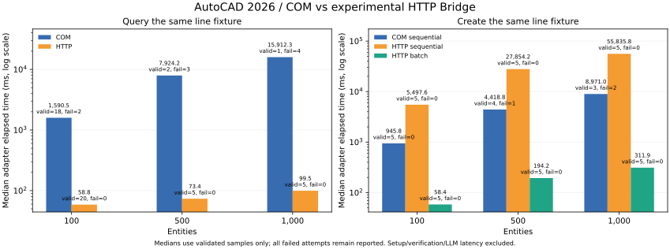

# CAD-09 故障测试与双后端性能报告

记录日期：2026-11-19（Asia/Shanghai）。COM 继续为默认后端。

## 范围与方法

本轮验证现有 Bridge 工具与成功路径的逐条/批量任务，不将其解释为全部工具迁移或默认后端切换验收完成。
使用合成图纸、相同 acadiso 模板、毫米单位和固定几何；每个性能样本在计时外新建图纸并重启 Bridge。预热 3 次，常规测量 20 次；配对预热超过 5 秒的重任务统一测量 5 次。样本不足 20 次不计算 P95。具体计划、重任务减样理由和失败样本均保留。

计时边界为 Python 后端 API，包含派发、序列化、HTTP 轮询和 CAD 执行；不包含 LLM、MCP 传输、图纸准备、校验、显式视图刷新和清理。HTTP 批量与 COM 逐条仅比较成功任务的几何与耗时，不视为同等原子事务。

详细复现方法见 [benchmarks/README.md](../../benchmarks/README.md)。

## 运行记录（含失败尝试）

| 运行 | 阶段 | 完成清理 | 状态/错误 | 原始样本 |
| --- | --- | --- | --- | --- |
| benchmark-01 | benchmark | True | 完成，但有失败 | [JSONL](../../benchmarks/results/2026-11-19/benchmark-01/cases.jsonl) |
| fault-01 | faults | False | TimeoutError | [JSONL](../../benchmarks/results/2026-11-19/fault-01/cases.jsonl) |
| fault-02 | faults | False | TimeoutError | [JSONL](../../benchmarks/results/2026-11-19/fault-02/cases.jsonl) |
| fault-03 | faults | False | com_error | [JSONL](../../benchmarks/results/2026-11-19/fault-03/cases.jsonl) |
| fault-04-busy | faults | False | RuntimeError | [JSONL](../../benchmarks/results/2026-11-19/fault-04-busy/cases.jsonl) |
| fault-05-helper | faults | False | 进行中/未完成；后续独立复核清理完成（原始失败保留） | [JSONL](../../benchmarks/results/2026-11-19/fault-05-helper/cases.jsonl) |
| fault-06-full | faults | True | 完成 | [JSONL](../../benchmarks/results/2026-11-19/fault-06-full/cases.jsonl) |
| restart-01 | cad_restart | True | 完成 | [JSONL](../../benchmarks/results/2026-11-19/restart-01/cases.jsonl) |
| soak-01 | soak | False | TypeError | [JSONL](../../benchmarks/results/2026-11-19/soak-01/cases.jsonl) |
| soak-02 | soak | False | InterruptedError | [JSONL](../../benchmarks/results/2026-11-19/soak-02/cases.jsonl) |
| soak-03 | soak | False | 进行中/未完成；后续独立复核清理完成（原始失败保留） | [JSONL](../../benchmarks/results/2026-11-19/soak-03/cases.jsonl) |

## 环境

- CAD：25.1s (LMS Tech)；SDK：8.0.428；Python：3.11.15。
- CPU：Intel(R) Core(TM) i7-14650HX；物理内存：31.71 GiB。
- 被测 DLL SHA-256：`0aefe2db4f50bf3a4e559c3c99294c13f48e75bdfdc92d51b4d50d4f9ee89627`。
- 性能代码基线：`302a98b875baec72822882d491e597273067b5c2`；各次故障/连续测试的确切版本及源文件哈希以对应 environment.json 为准。
- 既有 Web 工作区改动未纳入本轮提交；没有使用私有 DWG。

## 原生故障矩阵

通过 18 项，失败 0 项，未执行 0 项。

| 用例 | 状态 | 证据或限制 |
| --- | --- | --- |
| authentication_origin_host | passed | {"auth_status": 401, "origin_status": 403, "host_status": 403} |
| invalid_geometry_no_residue | passed | {"rejected": 3, "additional_entities": 0, "layer_changes": 0} |
| atomic_rollback_0 | passed | {"failed_index": 0, "terminal_status": "rolled_back", "additional_entities": 0, "layer_changes": 0} |
| atomic_rollback_2 | passed | {"failed_index": 2, "terminal_status": "rolled_back", "additional_entities": 0, "layer_changes": 0} |
| atomic_rollback_4 | passed | {"failed_index": 4, "terminal_status": "rolled_back", "additional_entities": 0, "layer_changes": 0} |
| deduplication_and_request_conflict | passed | {"submissions": 3, "entities": 1, "duplicate_side_effects": 0, "conflict_rejected": true} |
| active_document_switch_both_backends | passed | {"http_bound_target_respected": true, "com_switched_document_rejected": true, "wrong_document_writes": 0} |
| closed_document_stale_id_and_wrong_session | passed | {"closed_document_rejected": true, "wrong_session_rejected": true, "wrong_document_writes": 0} |
| external_edit_revision_conflict | passed | {"external_com_edit_observed": true, "stale_write_rejected": true, "entities": 1} |
| lost_post_response_no_replay | passed | {"injection": "response discarded after forwarding real POST", "write_posts": 1, "final_status": "succeeded", "entities": 1, "duplicate_side_effects": 0} |
| poll_disconnect_no_replay | passed | {"write_posts": 1, "pending_status": "queued", "recovered_status": "succeeded", "entities": 1, "duplicate_side_effects": 0} |
| wait_timeout_no_replay | passed | {"write_posts": 1, "pending_status": "queued", "recovered_status": "succeeded", "entities": 1, "duplicate_side_effects": 0} |
| busy_queue_capacity_and_drain | passed | {"queued": 64, "rejected": 6, "terminal": 70, "hanging_jobs": 0} |
| stop_with_pending_write_and_readback | passed | {"initial_status": "queued", "client_outcome": "outcome_unknown", "write_posts": 1, "observed_entities": 0, "duplicate_side_effects": 0} |
| journal_capacity_and_explicit_recovery | passed | {"successful_queries_before_limit": 2045, "capacity": 2048, "overflow_code": "QUEUE_FULL", "explicit_restart_recovered": true} |
| bridge_restart_instance_and_ownership | passed | {"distinct_instances": 4, "old_client_rejected": true, "new_client_recovered": true} |
| port_conflict_and_recovery | passed | {"cad_survived": true, "port_release_recovered": true} |
| cad_process_restart | passed | {"separate_run": "restart-01", "old_client_rejected": true, "explicit_recovery_verified": true, "original_processes_preserved": true} |

注：断连通过客户端传输故障注入实现，底层写请求真实到达 Bridge；revision 外部修改由 COM 执行，不冒充人工 UI 操作。

CAD 进程重启证据另见 [restart-01](../../benchmarks/results/2026-11-19/restart-01/restart.json)；原始主矩阵的未执行记录保持不变。

## 连续混合调用

- 持续 30.01 分钟；成功 1793 次，失败 0 次。
- 混合调用描述性 P50 / P95：53.74 / 60.14 ms；不同操作混合，不用于后端速度对比。
- CAD 私有内存：2257.1 → 2464.2 MiB。
- 每分钟资源原始值保留在 JSONL 中。单次 30 分钟结果不能证明长期无泄漏。
- 初次收尾探测超时，原 qualification.json 保留 completed=false；后续独立 COM/TCP 复核确认自建图纸与监听已清理。详见该运行 cleanup-recovery.json，不能把原始失败改写为全程无故障。

## 性能对照

以下单位均为毫秒。失败数不从样本数中隐藏；P95 的空白表示样本量不足。

| 场景 | 实体数 | 后端 / 模式 | 样本 | 失败 | 中位数 | P95 | 最大值 |
| --- | ---: | --- | ---: | ---: | ---: | ---: | ---: |
| cold_attach | 0 | com / single | 20 | 0 | 61.70 | 84.09 | 88.15 |
| cold_attach | 0 | http / single | 20 | 0 | 63.82 | 84.18 | 91.86 |
| create | 100 | com / single | 5 | 0 | 945.78 | — | 969.60 |
| create | 100 | http / batch | 5 | 0 | 58.40 | — | 59.74 |
| create | 100 | http / single | 5 | 0 | 5,497.61 | — | 5,524.20 |
| create | 500 | com / single | 5 | 1 | 4,418.83 | — | 4,757.49 |
| create | 500 | http / batch | 5 | 0 | 194.16 | — | 201.84 |
| create | 500 | http / single | 5 | 0 | 27,854.25 | — | 27,932.09 |
| create | 1000 | com / single | 5 | 2 | 8,971.04 | — | 9,059.17 |
| create | 1000 | http / batch | 5 | 0 | 311.95 | — | 326.98 |
| create | 1000 | http / single | 5 | 0 | 55,835.85 | — | 56,007.39 |
| query | 100 | com / single | 20 | 2 | 1,590.45 | — | 1,776.66 |
| query | 100 | http / single | 20 | 0 | 58.76 | 59.92 | 62.30 |
| query | 500 | com / single | 5 | 3 | 7,924.23 | — | 7,933.59 |
| query | 500 | http / single | 5 | 0 | 73.42 | — | 134.02 |
| query | 1000 | com / single | 5 | 4 | 15,912.29 | — | 15,912.29 |
| query | 1000 | http / single | 5 | 0 | 99.49 | — | 168.91 |

### 结果解释

- 共 145 个测量样本，失败 12 个；另有 6 个预热失败，均保留在原始 JSONL。
- COM：53 / 65 个测量样本通过几何校验。
- HTTP：80 / 80 个测量样本通过几何校验。
- 中位数仅来自成功样本；COM 失败样本导致选择偏差，不应据此宣称普遍加速比或双后端验收全部通过。
- HTTP 逐条与 HTTP 批量必须分开看：逐条调用受网络往返及当前 50 ms 轮询间隔影响；批量将多步放在一次任务中。该归因是实现与测量边界的解释，不是独立的延迟分解实验。
- 本轮性能阶段完成且清理成功，但存在失败样本，benchmark.passed=false；后续应定位 COM 引用/几何读取失败后按同一计划重新测量。
- 测量失败类型：AttributeError × 4、KeyError × 1、com_error × 7。错误类型本身不足以确诊根因；不得直接将 KeyError 等同于 CAD 几何错误。

### 抽样依据

- cold_attach / 0：20 次；Standard repetition count。
- query / 100：20 次；Standard repetition count。
- create / 100：5 次；Paired warmup max 5.539s exceeds declared 5.0s heavy threshold; use 5 repeats for every mode in this group。
- query / 500：5 次；Paired warmup max 9.533s exceeds declared 5.0s heavy threshold; use 5 repeats for every mode in this group。
- create / 500：5 次；Paired warmup max 27.959s exceeds declared 5.0s heavy threshold; use 5 repeats for every mode in this group。
- query / 1000：5 次；Paired warmup max 16.160s exceeds declared 5.0s heavy threshold; use 5 repeats for every mode in this group。
- create / 1000：5 次；Paired warmup max 55.741s exceeds declared 5.0s heavy threshold; use 5 repeats for every mode in this group。

冷连接只指 CAD 已启动时的首次后端连接，不是 AutoCAD 冷启动。逐样本的请求数、响应体大小、Bridge 队列/执行时间及内存数据见原始记录。归一化的 common_json_bytes 只用于相同字段比较，不是 COM IPC 传输字节数。

## 清理与结论边界

各运行 cleanup.json 独立记录测试图纸、监听停止及原活动图纸恢复结果。用户原有 CAD 实例保留；只有显式标为自建且无原有文档的进程才允许退出。

本轮不切换默认 COM。HTTP 目前的工具覆盖、查询上限、部署矩阵及持久故障恢复仍有限；未执行项和失败运行均须保留，不能将本报告描述为全部路线图已验收。
